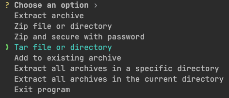

## One CLI that supports multiple compression formats.
### Usage:
Run `cargo run` to open the interactive menu, then choose an operation. The menu supports extracting archives, creating ZIP or TAR archives, password-protecting ZIP files, adding files to an existing archive, and extracting multiple archives.

For direct command-line use, pass an action and a file or directory path: `cargo run -- [action] [path to file or directory]`.
- extract all archives that will be found in current directory: `cargo run -- -xa .`
- extract specific: `cargo run -- -x "./my/dir/archive.zip"`
- tar: `cargo run -- -t "./my/dir/file.png"`
- zip all txt files in current dir: `cargo run -- -z "./*.txt"`
- zip with password encryption: `cargo run -- -ze "./my/dir/some_prefix*"`

### I prefer alias to use it anywhere:
`$ alias zip-tar-cli="cargoRun --manifest-path /Users/foo/bar/zip-tar-cli/Cargo.toml --"`
 
`$ zip-tar-cli -x ./some/dir/archive.zip`
